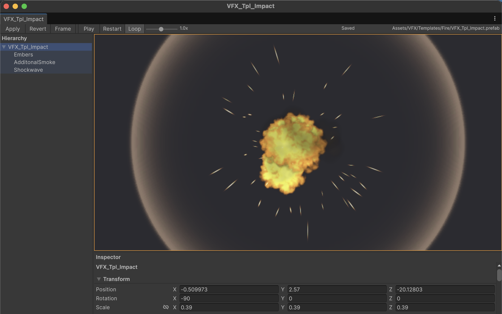

# Multitude

Edit several prefab assets at the same time, each one in its own window, without touching the scene you
have open and without going through Unity's prefab stage.

Each window owns an isolated session: its own hierarchy, its own preview, its own inspector. Changes
stay inside the window until you press **Apply**; **Revert** throws them away. If the prefab file
changed on disk in the meantime, Apply refuses to overwrite it and asks you what to do.



**Landing page:** open `docs/index.html` locally, or enable GitHub Pages with *Settings → Pages →
Deploy from branch → `main` / `/docs`* and it will be served at
`https://<your-user>.github.io/Multitude/`.

## Requirements

| | |
|---|---|
| Unity | **6000.6** (Unity 6.6) or newer |
| Render pipeline | tested with URP 17.6; nothing pipeline specific in the code |
| Platform | Editor only, no runtime assembly |

## Install

**Local path (development):** in `Packages/manifest.json` of your project add

```json
"com.gabs.multitude": "file:../Multitude"
```

or use `Window > Package Manager > + > Add package from disk...` and pick this folder's `package.json`.

**Git URL (once the repository is published):** `Window > Package Manager > + > Add package from git URL...`

```
https://github.com/<your-user>/Multitude.git
```

You can pin a version with `#v0.1.0` or a commit hash.

## Usage

- `Assets > Multitude > Open Prefab in Multitude` (right click a prefab) or
  `Tools > Multitude > Open Selected Prefabs`.
- Preview: left drag orbits, right drag or `Alt`+left pans, the wheel zooms, `F` frames. Double click
  an object in the hierarchy to frame it.
- Drag the separators to resize the hierarchy column and the inspector; double click a separator to
  reset its size. Each window remembers its own layout.
- Particle systems and VFX play in the preview: `Play`/`Pause`, `Restart`, `Loop` and a speed slider.
- `Apply` writes the prefab asset, `Revert` reloads it from disk, closing a dirty window asks first.

Full details, limits and troubleshooting: [Documentation~/MVP.md](Documentation~/MVP.md).

## How it stays isolated

Unity renders any object that lives in a loaded scene, even with `HideAndDontSave`, so preview objects
are created hidden, put on a private layer and taken out of every camera with
`Renderer.forceRenderingOff`. They are switched on only while the preview renders its own frame, and
left over copies are destroyed when scripts reload. Your scene, scene view, game view and prefab stage
never see anything from Multitude.

## Tests

The package ships EditMode tests. To run them, add the package to the testables of your project's
`Packages/manifest.json`:

```json
"testables": ["com.gabs.multitude"]
```

Then open `Window > General > Test Runner > EditMode`.

## Layout

```
package.json                  package manifest (Unity 6000.6+)
Editor/Core/                  asset validation, snapshots, edit session
Editor/UI/                    preview view, preview host, VFX playback, hierarchy, inspector
Editor/Windows/               the per prefab window
Editor/Commands/              menu entries
Tests/Editor/                 EditMode tests
Documentation~/MVP.md         usage, limits and troubleshooting
docs/                         landing page (English in /, Spanish in /es/, GitHub Pages ready)
```

## License

Dual licensed: **LGPL-3.0** or **AGPL-3.0**, your choice per copy or distribution — the notice is in
[LICENSE](LICENSE) and the full texts in [`licenses/`](licenses).

- **LGPL-3.0** (`licenses/LGPL-3.0.txt`, which builds on `licenses/GPL-3.0.txt`) lets you ship
  Multitude inside a closed product, as long as the library itself — and any modification you make to
  it — stays under the LGPL and the user can replace it. This is the option that fits a sold or closed
  Unity tool.
- **AGPL-3.0** (`licenses/AGPL-3.0.txt`) is strong copyleft and also covers offering the tool as a
  service.

Neither option is permissive in the MIT sense: modifications to the library stay open. Weigh that
before bundling it into a commercial asset.
